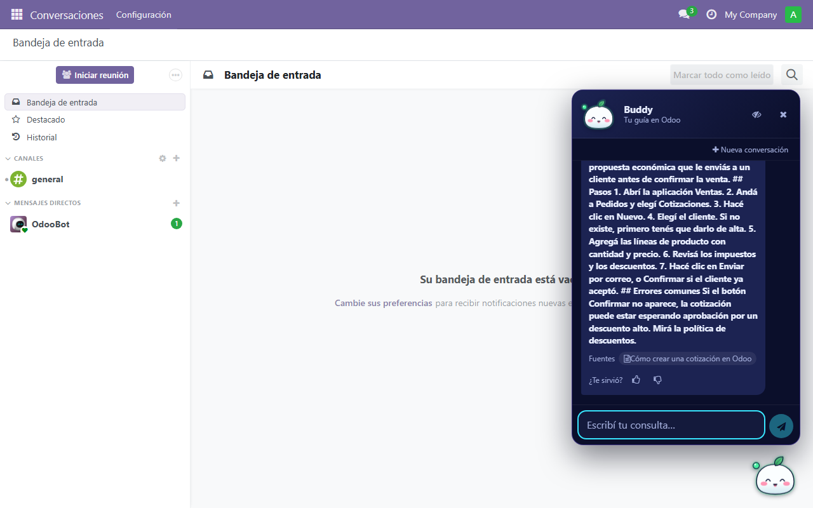

> Read this in English: [README.md](README.md)

# Buddy IA para Odoo 18

**Buddy es un asistente flotante para Odoo 18 Community: tus empleados le preguntan y responde con los documentos de las carpetas de Google Drive de la empresa, citando de dónde sacó cada dato y mostrando solo lo que cada persona tiene permiso de ver.**

Es para equipos que quieren que "¿cómo hago X?" se conteste solo, sin buscar en carpetas ni interrumpir a nadie. Lo instala y mantiene una persona que administre Odoo; no hace falta ser programador ni DBA.

> **Estado honesto (18.0.5.5.0):** el flujo completo se probó en Odoo 18 con una IA simulada (más de 1.500 pruebas automáticas) y la v2 también contra **Google Drive y Gemini reales** sobre una copia de prueba. **Sin probar todavía:** Claude y OpenAI reales (el código los soporta), lector de pantalla y celular táctil reales, y un corpus grande de documentos. Detalle en [docs/VALIDATION.md](docs/VALIDATION.md). Probalo primero en un entorno de prueba.



## Cómo funciona

1. Vos compartís carpetas de Google Drive (solo lectura) con una "cuenta robot" de Google (una cuenta de servicio).
2. En Odoo cargás cada carpeta y elegís qué grupos de Odoo pueden consultarla.
3. Odoo lee los documentos solo (una vez por día, o cuando apretás **Sincronizar ahora**) y los guarda troceados en su propia base.
4. Cuando alguien pregunta, Odoo busca los fragmentos más parecidos **dentro de las carpetas de esa persona** (búsqueda de texto de Postgres, sin IA; y, si el administrador lo activa, también **por significado**: encuentra la respuesta aunque la pregunta use otras palabras que el documento. Es opcional y viene apagada porque manda el texto de las carpetas al proveedor de IA; ver [SECURITY](docs/SECURITY.md#búsqueda-por-significado-qué-se-envía-y-quién-ve-los-vectores)).
5. Esos fragmentos + la pregunta se mandan al proveedor de IA que elegiste, que redacta la respuesta. Se muestra con enlaces a los documentos de Drive. Si no hay nada relevante, lo dice y ofrece un contacto o un ticket. Si dos documentos dicen cosas distintas, lo avisa y cita los dos en vez de elegir uno; si la evidencia es floja, dice que no está seguro y ofrece a quién consultar. Debajo de cada respuesta hay un 👍 y un 👎 **anónimos** (el panel «Calidad de respuestas» le muestra al administrador qué documentos acumulan más 👎).

```text
 Google Drive           Odoo 18 (tu servidor)                        Proveedor de IA
 ┌──────────┐  lee   ┌─────────────────────────────┐                (Claude / OpenAI /
 │ Carpetas │ ─────► │ Sincronización (cron)       │                 Gemini / otro)
 │ (solo    │        │   └► fragmentos en Postgres │                      ▲
 │ lectura) │        │                             │  pregunta +          │
 └──────────┘        │ Empleado ─► pregunta ─►     │  fragmentos          │
                     │   búsqueda de texto         │  permitidos ─────────┘
                     │   (solo sus grupos)    ─────┼─► respuesta + fuentes
                     └─────────────────────────────┘
```

Los documentos completos **no** se mandan al proveedor: solo los fragmentos relevantes de cada consulta.

**Onboarding (desde 18.0.5.3.0):** además de contestar, Buddy acompaña a las personas nuevas. RR.HH. arma **recorridos** (pasos con un día relativo al ingreso: día 1, semana 1, mes 1), los asigna, y cada persona ve **«Tus tareas de hoy»** en el chat, las tilda, abre el documento que corresponde y le pregunta al buddy con un toque; RR.HH. ve el avance sin leer ninguna conversación. Ver la [guía de administración](docs/ADMIN-GUIDE.md#onboarding-recorridos-por-rol-y-etapa).

**Proactividad suave (desde 18.0.5.4.0):** los botones de sugerencia del chat se arman para cada persona (sus tareas y los temas que más consulta la empresa), el buddy avisa con un globito discreto cuando hay tareas para hoy y cada lunes los administradores reciben un **resumen de qué falta documentar** (sin IA, con datos anónimos, con una actividad de Odoo y nunca un correo). Todo se apaga desde Ajustes. Ver la [guía de administración](docs/ADMIN-GUIDE.md#sugerencias-a-medida-aviso-de-tareas-y-resumen-semanal).

## Qué necesitás

- Una **cuenta de Google** con Drive, para crear la cuenta de servicio y tener las carpetas (guía paso a paso: [docs/GOOGLE-DRIVE.md](docs/GOOGLE-DRIVE.md)).
- Una **clave de API** de un proveedor de IA (Claude/Anthropic, OpenAI, Google Gemini u otro compatible con OpenAI). Se paga por uso, al proveedor.
- Un **Odoo 18 Community** donde puedas instalar un addon (acceso al servidor, Linux).
- Nada más: **sin pgvector (los vectores de la búsqueda por significado son un `bytea` común), sin extensiones de Postgres, sin DBA, sin Docker en producción.**

Odoo Online no sirve (no admite addons propios). Odoo.sh y Enterprise: no se probaron.

## Probalo en 3 pasos (demo con Docker)

La demo corre en tu compu con documentos ficticios y **una IA simulada**: no gasta plata, no necesita claves y no toca ningún Odoo real. Tampoco usa Google: carga tres carpetas de ejemplo que no se sincronizan.

1. **Instalá Docker Desktop:** [docker.com/products/docker-desktop](https://www.docker.com/products/docker-desktop/). Abrilo y esperá a que diga que está funcionando (en Windows puede pedirte activar WSL 2 y reiniciar).
2. **Instalá Python 3.12:** [python.org/downloads](https://www.python.org/downloads/). En Windows, tildá "Add python.exe to PATH".
3. **Abrí una terminal en esta carpeta y corré:**

   ```text
   python tools/manage.py demo
   ```

   Si `python` no anda: `py tools/manage.py demo` (Windows) o `python3 tools/manage.py demo` (Mac/Linux).

**Qué esperar:** la primera vez descarga imágenes y arma todo, así que tarda varios minutos (no lo medimos con precisión). Después se abre <http://127.0.0.1:8070>.

**Usuarios:** `admin`, `ana` (ve las carpetas General y Ventas) y `leo` (solo General). Preguntale "¿cómo creo una cotización?" con `ana` y con `leo` y compará.

**Contraseñas:** se generan solas y quedan en el archivo **`.env`** de esta carpeta (empieza con punto; activá "mostrar archivos ocultos" si no lo ves). Es privado: no lo subas ni lo mandes por mail.

| Usuario | Línea en `.env` |
|---|---|
| admin | `BUDDY_ADMIN_PASSWORD` |
| ana | `BUDDY_ANA_PASSWORD` |
| leo | `BUDDY_LEO_PASSWORD` |

**Ojo con las respuestas de la demo:** como la IA es simulada, las respuestas son el texto del documento sin redactar (a veces con aspecto de "copiado y pegado"). Con una IA real se redactan en lenguaje natural.

Para apagar todo: `python tools/manage.py down` (no borra tus datos).

## Instalarlo en tu Odoo

1. Copiá la carpeta `odoo-addons/buddy_ia` a una carpeta que esté en el `addons_path` de tu Odoo.
2. Instalá las 3 librerías de Python: `pip install -r odoo-addons/requirements.lock` (pypdf, PyJWT, packaging).
3. Reiniciá Odoo, activá el modo desarrollador y en **Aplicaciones** apretá **Actualizar lista de aplicaciones**; buscá "Buddy IA" e instalalo (o `odoo -d TU_BASE -i buddy_ia --stop-after-init`).
4. Seguí la [guía de Google Drive](docs/GOOGLE-DRIVE.md) y configurá todo en **Ajustes > Buddy IA** (la lista "Para empezar" te va tildando los pasos).
5. Apretá **Probar conexión**. Si da bien, ya podés usarlo.

Paso a paso completo, actualizar, desinstalar y "si algo falla": [docs/INSTALL.md](docs/INSTALL.md).

## Documentación

| Documento | Para qué |
|---|---|
| [INSTALL](docs/INSTALL.md) | Instalar, actualizar y desinstalar en un Odoo existente |
| [GOOGLE-DRIVE](docs/GOOGLE-DRIVE.md) | Crear la cuenta de servicio y conectar carpetas (para quien lo hace por primera vez) |
| [ADMIN-GUIDE](docs/ADMIN-GUIDE.md) | Organizar carpetas, mantener la calidad, preguntas de prueba, costos |
| [CUSTOMIZE](docs/CUSTOMIZE.md) | Ajustes, cómo extender el motor y cómo sumar **la mascota de tu empresa** como módulo aparte |
| [SECURITY](docs/SECURITY.md) | Quién ve qué, qué sale a Google y al proveedor, checklist de producción |
| [ARCHITECTURE](docs/ARCHITECTURE.md) | Cómo está hecho |
| [RISKS](docs/RISKS.md) · [ROADMAP](docs/ROADMAP.md) | Límites conocidos y qué falta |
| [VALIDATION](docs/VALIDATION.md) · [CHANGELOG](docs/CHANGELOG.md) | Qué se probó (y qué no) y qué cambió |
| [EVALUACION](docs/EVALUACION.md) | Conjunto dorado y harness para medir la calidad del buddy con la IA real (v2) |

## Contenido de la carpeta

| Carpeta | Contenido |
|---|---|
| `odoo-addons/buddy_ia` | El módulo (con dos personajes, Kitsune y Mochi) (lo único que se instala en producción) y `requirements.lock` |
| `tools` | Instalador de la demo (`manage.py`) y verificaciones |
| `demo` | Documentos ficticios y servidor de IA simulado (solo demo) |
| `examples/buddy_ia_mascot_example` | Plantilla de módulo para sumar un personaje propio sin tocar `buddy_ia` |
| `docker`, `docker-compose.yml` | Entorno de la demo y de las pruebas (no hace falta en producción) |
| `docs` | Documentación |

Licencia LGPL-3 (ver [NOTICE.md](NOTICE.md), que también cubre licencias de dependencias).
